# build123d-techdraw

[](https://github.com/szubster/build123d-techdraw/actions/workflows/ci.yml)
[](https://pypi.org/project/build123d-techdraw/)
[](https://pypi.org/project/build123d-techdraw/)
[](https://opensource.org/licenses/Apache-2.0)
[](https://github.com/astral-sh/ruff)
[](https://mypy-lang.org/)

**build123d-techdraw** is a modern, high-performance, Apache 2.0-licensed 2D technical drawing, GPU-shaded illustration, and interactive 3D-in-2D blueprint engine for [`build123d`](https://github.com/gumyr/build123d) (v0.13.0+) and Python CAD.

[Browse Examples Gallery](gallery.md){ .md-button .md-button--primary }
[Try Live 3D HTML5 Blueprint](user-guide/interactive-3d-html.md){ .md-button }
[GPU & Shaders Guide](user-guide/gpu-acceleration.md){ .md-button }

---

## 🎯 Why build123d-techdraw?

| Feature | `build123d-techdraw` | `draftwright` | `build123d-drafting-helpers` |
| :--- | :--- | :--- | :--- |
| **Open Source License** | **Apache 2.0** (Permissive, enterprise friendly) | AGPLv3 (Copyleft, restrictive) | MIT |
| **build123d Compatibility** | **>= 0.13.0** (Strictly stable public APIs) | < 0.12 (Crashes on OCP symbols) | Legacy |
| **Annotation Architecture** | **True 2D Paper-Space (mm)** | 3D B-Rep sketch faces (bloats kernel) | Pure 2D overlay |
| **Interactive Dual-Theme SVG** | **Yes** (Dark Blueprint ↔ Clean White ISO) | No (Raster/Basic SVG) | No |
| **GPU Shaded + Vector Views** | **Yes** (Opt-in WebGPU: Gooch, Toon, Blueprint, BOM, X-Ray + SSAO) | No | No |
| **GPU Visibility-Buffer HLR** | **Yes** (Fast WebGPU depth + Face-ID HLR with crisp vector output) | No | No |
| **SDF / JFA Smart Layout** | **Yes** (2D Euclidean clearance field for dims, balloons & leaders) | No | No |
| **Interactive 3D HTML5 Export** | **Yes** (Zero-CDN WebGL2 viewport, section cut, explode, BOM linking) | No | No |
| **Standard ISO 5457 Borders** | **Yes** (A0–A4 portrait/landscape, grid marks) | Custom templates | Partial |
| **ISO 7200 Title Blocks** | **Yes** (Configurable fields, projection cones) | Hardcoded | Minimal |
| **GD&T Feature Control Frames** | **Yes** (ISO 1101 geometric tolerances & datums) | No | No |
| **ISO 1302 Surface Roughness** | **Yes** (Machining required/prohibited symbols) | No | No |
| **Automated Multi-View Layout** | **Yes** (ISO first-angle default, auto-scale solver, parallel projection) | Manual view placement | Manual |
| **Automated Assembly BOM** | **Yes** (Recursive component discovery & balloons) | Manual BOM tables | No |
| **Multi-Format Export** | **SVG, Native PDF 1.4 (16×–30× faster), 1:1 DXF, 3D HTML5** | SVG / PDF | SVG |

---

## 🚀 Key Architectural Principles

1. **Paper-Space Hybrid Vector Architecture:**
   Annotations (dimensions, GD&T frames, title blocks, notes) never pollute the 3D CAD B-Rep kernel. 3D geometry is projected to 2D view vectors (exact OCCT or optional **WebGPU Visibility-Buffer HLR**), and all dimension lines and text are computed in true paper space ($mm$). Text heights ($2.5\text{ mm}$, $3.5\text{ mm}$) and arrowheads remain crisp and invariant regardless of view scale.

2. **Optional WebGPU Shading, HLR & SDF Smart Layout:**
   Install `build123d-techdraw[gpu]` to unlock WGSL technical-illustration shaders (`ViewStyle.GOOCH`, `BLUEPRINT_SHADED`, `SHADED_WITH_EDGES`, `TOON`, `XRAY`) with 16-sample SSAO underneath exact vector edges, fast GPU visibility-buffer HLR for complex assemblies, and 2D Jump-Flooding Distance Fields (with automatic CPU SciPy EDT fallback) for collision-free annotation placement.

3. **Zero-CDN Interactive 3D-in-2D HTML5 & Native PDF 1.4:**
   Export a single self-contained `.html` file pairing your dual-theme 2D ISO sheet with a live WebGL2 3D inspector (orbit, X/Y/Z section-plane cut with procedural hatching, assembly explode, BOM linking), or export print-ready vector + RGBA shaded PDFs 16×–30× faster via the built-in native PDF 1.4 engine.

4. **Dual-Theme Interactive SVG & Automated Multi-View Layout:**
   ISO 128-3 first-angle projection is the default (ASME third-angle opt-in), with automatic ISO 5455 scale solving, parallel multi-view projection, and one-click **Dark Blueprint ↔ Clean White ISO** theme switching.

---

## ✨ Featured Preview: WebGPU Shaded + Vector-Edge Technical Views



!!! tip "Explore More"
    See all 12 runnable examples in the [Examples Gallery](gallery.md) or interact with a live 3D assembly directly in your browser on the [Interactive 3D HTML](user-guide/interactive-3d-html.md) page.

---

## 📦 Installation

```bash
# Core package (100% GPU-free, using uv)
uv add build123d-techdraw

# Optional WebGPU acceleration (shaded views, GPU HLR, WGSL JFA SDF)
uv add build123d-techdraw --extra gpu

# Or with pip
pip install "build123d-techdraw[gpu]"
```

---

## ⚡ 30-Second Quickstart

```python
import build123d as bd
from build123d_techdraw import DrawingSheet, SheetSize, add_standard_multiview

# 1. Create a 3D CAD part
part = bd.Box(100.0, 50.0, 30.0)

# 2. Set up an ISO A3 drawing sheet
sheet = DrawingSheet(sheet_size=SheetSize.A3_LANDSCAPE)
sheet.set_title_block(
    title="ENCLOSURE BASE",
    drawing_number="DWG-001",
    author="J. DOE",
)

# 3. Add standard multi-view with automatic scale and dimensions
layout = add_standard_multiview(
    sheet=sheet,
    shape=part,
    scale="auto",
    auto_dimensions=True,
)

# 4. Export to interactive SVG, multi-page vector PDF, and 1:1 DXF
sheet.export_svg("drawing.svg")
sheet.export_pdf("drawing.pdf")
sheet.export_dxf("drawing.dxf")
```

### 🖼️ Generated Output Preview


!!! tip "Runnable Examples"
    Complete runnable example scripts and their output files (SVG, vector PDF, and DXF) are provided in the repository's `examples/` directory. You can regenerate all drawings with `uv run python examples/generate_all.py`.
