# GPU Acceleration, Shaders, HLR & SDF Layout

`build123d-techdraw` ships an **optional, cross-platform WebGPU (`wgpu`) acceleration engine** for technical illustration shading, fast visibility-buffer Hidden-Line Removal (HLR), and 2D Euclidean Distance-Field (SDF) smart annotation placement.

The core package remains **100% GPU-free** and works out of the box with zero GPU dependencies.

---

## Opt-In Installation & Runtime Detection

Install the optional `gpu` extra (which pulls in `wgpu`):

=== "uv"

    ```bash
    uv add build123d-techdraw --extra gpu
    ```

=== "pip"

    ```bash
    pip install "build123d-techdraw[gpu]"
    ```

### Cross-Platform WebGPU & Headless CI

`wgpu` targets native GPU backends across every major desktop OS:

- **Linux:** Vulkan (hardware GPUs) or **Mesa Lavapipe** software Vulkan driver in headless CI containers
- **macOS:** Metal
- **Windows:** DirectX 12 / Vulkan

### Runtime Diagnostics & Environment Controls

Inspect or override GPU acceleration at runtime using `build123d_techdraw.gpu`:

```python
from build123d_techdraw.gpu import gpu_info, is_gpu_available, is_gpu_enabled

print("Available:", is_gpu_available())
print("Enabled:  ", is_gpu_enabled())
print("Details:  ", gpu_info())
```

Control GPU usage globally with the `BUILD123D_TECHDRAW_GPU` environment variable or per-call with `gpu=True | False | None`:

| Setting | Behaviour |
| :--- | :--- |
| `BUILD123D_TECHDRAW_GPU=0` (or `false`, `off`, `no`) | Force CPU-only execution without probing GPU adapters. |
| `BUILD123D_TECHDRAW_GPU=1` (or `true`, `on`, `yes`) | Require a working `wgpu` adapter (raises `ImportError` / `RuntimeError` if unavailable). |
| Unset / `auto` (default) | Auto-enable GPU whenever `wgpu` is installed and a hardware or software adapter initializes. |

---

## Shaded + Vector-Edge Technical Views

GPU-shaded views render an offscreen supersampled RGBA technical illustration using custom WGSL shaders (G-buffer normals + depth, 16-sample hemisphere **SSAO**, and style-specific lighting) and composite it **underneath exact vector outlines** in `#layer_visible`. Lines, dimensions, GD&T frames, and text remain 100% crisp vectors.

### Supported `ViewStyle` Modes

| `ViewStyle` | Description |
| :--- | :--- |
| `ViewStyle.WIREFRAME` | Classic exact vector drawing (default, zero GPU work). |
| `ViewStyle.SHADED` | Smooth technical shading without a vector edge overlay. |
| `ViewStyle.SHADED_WITH_EDGES` | Smooth technical shading underneath exact vector edges. |
| `ViewStyle.GOOCH` | Gooch cool-to-warm technical illustration shading + subtle SSAO + vector edges. |
| `ViewStyle.TOON` | Quantized cel-shaded bands + vector edges. |
| `ViewStyle.BLUEPRINT_SHADED` | Holographic blueprint shading (cyan in dark theme, gray-blue in ISO white) + vector edges. |
| `ViewStyle.XRAY` | Fresnel translucent additive shading revealing internal bores & passages + vector edges. |

### Styling Options & Dual-Theme Export

Pass shading options directly to `sheet.add_view(...)` or any builder view (`FrontView`, `IsometricView`, etc.):

```python
from build123d_techdraw import DrawingSheet, SheetSize, ViewType
from build123d_techdraw.gpu import ViewStyle

sheet = DrawingSheet(SheetSize.A3_LANDSCAPE)
sheet.add_view(
    assembly,
    ViewType.ISOMETRIC,
    center=(200.0, 95.0),
    scale=1.0,
    style=ViewStyle.GOOCH,
    shading_dpi=220,  # Offscreen raster resolution (DPI in paper space)
    ssao=True,  # Screen-space ambient occlusion in bores & fillets
    color_by_part=True,  # Auto-assign distinct engineering BOM material colors
    part_colors={"Bronze Bushing": "#D4A24C"},  # Optional per-part overrides
)
sheet.export_svg("shaded_sheet.svg")
sheet.export_pdf("shaded_sheet.pdf")
```

- **Dual-Theme SVG Switching:** Both dark-blueprint and ISO-white shaded layers are embedded cleanly and switch automatically when the user toggles the SVG theme button.
- **Native PDF Embedding:** The native PDF 1.4 exporter embeds transparent RGBA shaded layers as compressed PDF raster XObjects with soft-mask alpha channels directly beneath the vector strokes.

### Shaded Technical Views Showcase



<div class="td-shader-grid" markdown>

<div class="td-shader-card">
  
  <div class="td-shader-caption">
    <strong>Gooch + SSAO</strong>
    Cool-to-warm technical illumination preserving edge legibility across ribs and counterbores.
  </div>
</div>

<div class="td-shader-card">
  
  <div class="td-shader-caption">
    <strong>Blueprint Shaded</strong>
    Holographic cyan blueprint shading matched to the Dark Blueprint sheet palette.
  </div>
</div>

<div class="td-shader-card td-light-bg">
  
  <div class="td-shader-caption">
    <strong>BOM Part Colors</strong>
    <code>color_by_part=True</code> distinguishes aluminium housing, bronze bushing, collar, and bolts.
  </div>
</div>

<div class="td-shader-card">
  
  <div class="td-shader-caption">
    <strong>X-Ray Fresnel</strong>
    Translucent additive shading exposing internal stepped through-bores and bolt seats.
  </div>
</div>

</div>

Run this example with `uv run python examples/shaded_technical_views.py`.

---

## GPU Visibility-Buffer HLR

For large assemblies with hundreds or thousands of B-Rep faces, OpenCASCADE's exact `HLRBRep_Algo` can become a bottleneck. `build123d-techdraw` includes a three-pass **WebGPU Visibility-Buffer HLR** engine that still outputs **crisp, themeable vector SVG, PDF, and DXF paths**:

1. **Orthographic Raster Pass:** Tessellated geometry is rasterized into a `depth32float` buffer plus packed depth and 1-based B-Rep **Face-ID** (`r32uint`).
2. **WGSL Compute Visibility Pass:** Every B-Rep edge and analytic/mesh silhouette is sampled and classified against a 3×3 pixel neighbourhood using depth + Face-ID self-occlusion checks.
3. **Vector Stitching & Simplification:** Contiguous visible and hidden runs are de-speckled, deduplicated, simplified with Ramer-Douglas-Peucker, and emitted in the exact same vector DOM structure as OCCT HLR.

### Selecting the HLR Backend

| Parameter | Values / Default | Purpose |
| :--- | :--- | :--- |
| `hlr` | `"exact"` (default), `"gpu"`, `"auto"` | Choose OCCT exact HLR, force GPU visibility-buffer HLR, or auto-switch on large shapes. |
| `hlr_resolution` | `int` (default `2048`) | Maximum visibility-buffer texture dimension in pixels. |
| `hlr_gpu_face_threshold` | `int` (default `250`) | Minimum B-Rep face count at which `hlr="auto"` switches from exact OCCT to GPU HLR. |

```python
from build123d_techdraw import BuildDrawing, FrontView, IsometricView, SheetSize
from build123d_techdraw.gpu import ViewStyle

with BuildDrawing(SheetSize.A3_LANDSCAPE) as sheet:
    # Fast GPU HLR on a complex multi-part assembly
    FrontView(
        gearbox_assembly,
        center=(175.0, 95.0),
        scale=0.5,
        hlr="auto",
        hlr_resolution=2048,
        hlr_gpu_face_threshold=250,
    )
    # Compose GPU HLR with GPU Shaded Views on the same view!
    IsometricView(
        gearbox_assembly,
        center=(322.0, 95.0),
        scale=0.5,
        style=ViewStyle.GOOCH,
        hlr="gpu",
    )
```


Run the finned gearbox assembly example and wall-clock benchmark with `uv run python examples/gpu_hlr_assembly.py`.

---

## Distance-Field (SDF / Jump Flooding) Smart Layout

Coarse axis-aligned bounding boxes (AABBs) waste large concave whitespace pockets around L-, C-, or T-shaped parts. `build123d-techdraw` computes a high-resolution **2D Euclidean Signed Distance Field (SDF)** of the entire sheet—incorporating exact projected view contours, margins, ISO 7200 title blocks, BOM/revision tables, and existing annotations—using a **WGSL Jump Flooding Algorithm (`JFA+1`)** compute shader, with automatic exact CPU fallback via `scipy.ndimage.distance_transform_edt`.

### Key SDF Layout Functions

- `compute_sheet_sdf(sheet, resolution_px_per_mm=2.0, gpu=None)` — rasterizes sheet obstacles and returns a `SheetDistanceField` with millimeter clearance queries and heatmap rendering.
- `auto_dimension_sheet(sheet, shape, use_sdf=True, sdf=sdf)` — stacks ISO 129-1 linear dimensions and places hole callouts into high-clearance pockets.
- `place_balloons_sdf(sheet, view, targets, sdf=sdf)` — places non-overlapping BOM balloons with clean, non-crossing leaders.
- `place_leaders_sdf(sheet, view, targets, sdf=sdf)` — places multi-line engineering leader notes into open whitespace.

```python
from build123d_techdraw.gpu.sdf import compute_sheet_sdf
from build123d_techdraw.layout.auto_dimension import (
    auto_dimension_sheet,
    place_balloons_sdf,
    place_leaders_sdf,
)

sdf = compute_sheet_sdf(sheet, resolution_px_per_mm=2.0)
auto_dimension_sheet(sheet, part, use_sdf=True, sdf=sdf)
place_balloons_sdf(sheet, layout.front, front_targets, radius_mm=4.0, sdf=sdf)
place_leaders_sdf(sheet, layout.isometric, leader_targets, sdf=sdf)

# Optional: inspect the millimeter clearance field visually
sdf.render_heatmap_image().save("clearance_heatmap.png")
```

<div class="td-gallery-grid" markdown>

<div class="td-gallery-card">
  <div class="td-gallery-media">
    
  </div>
  <div class="td-gallery-body">
    <h3>SDF-Placed Dimensions, Balloons & Leaders</h3>
    <p>L-shaped CNC hydraulic manifold annotated with zero <code>run_sheet_lint</code> issues, utilizing concave whitespace pockets around the valve tower and gusset rib.</p>
  </div>
</div>

<div class="td-gallery-card">
  <div class="td-gallery-media">
    
  </div>
  <div class="td-gallery-body">
    <h3>2D Millimeter Clearance Heatmap</h3>
    <p>Visualized output of <code>sdf.render_heatmap_image()</code> showing exact distance-to-obstacle contours computed via WebGPU JFA+1 (or SciPy EDT fallback).</p>
  </div>
</div>

</div>

Run this example with `uv run python examples/sdf_smart_layout.py`.

---

## CPU & Native PDF Performance + CI Visual Regression

Alongside optional WebGPU features, the core CPU pipeline has been heavily optimized:

- **4D Spatial-Hash Hidden-Edge Deduplication (~11× faster):** Replaces $O(H \cdot V)$ brute-force coincident edge filtering with an $O(H + V)$ spatial hash producing exact matches.
- **Process-Isolated Parallel Multi-View Projection:** Projects independent orthographic and isometric views concurrently across worker processes safely without sharing mutable OCCT kernel state.
- **Native PDF 1.4 Engine (16×–30× faster):** Writes pure PDF 1.4 vector streams directly without external Cairo/Inkscape subprocesses, including native RGBA `<image>` XObject + SMask support for GPU-shaded views.
- **Reproducible Benchmarks:** Run `uv run python examples/benchmark_performance.py` to measure hidden-edge dedup, parallel projection, and native PDF export on your machine.
- **Dual-Tier CI Verification:** Continuous integration verifies deterministic CPU golden SVGs **byte-for-byte**, while GPU-shaded and GPU-HLR outputs are rendered headlessly on **Mesa Lavapipe** and checked perceptually using `scikit-image` **SSIM** (Structural Similarity Index) against reference baselines.
