# build123d-techdraw Examples

This directory contains standalone, runnable examples demonstrating the capabilities of `build123d-techdraw` along with their generated vector outputs.

---

## 📁 Examples Overview

| Example Script | Description | Generated Outputs |
| :--- | :--- | :--- |
| [`quickstart_enclosure.py`](quickstart_enclosure.py) | Orthographic multi-view layout with automatic ISO 5455 scaling and envelope dimensions. | [SVG (Dark)](output/quickstart_enclosure.svg), [SVG (White)](output/quickstart_enclosure_white.svg), [PDF](output/quickstart_enclosure.pdf), [DXF](output/quickstart_enclosure.dxf) |
| [`assembly_bom.py`](assembly_bom.py) | Multi-component assembly with automated Bill of Materials (BOM) table and radiating balloon callouts. | [SVG (Dark)](output/assembly_drawing.svg), [SVG (White)](output/assembly_drawing_white.svg), [PDF](output/assembly_drawing.pdf), [DXF](output/assembly_drawing.dxf) |
| [`stepped_bracket.py`](stepped_bracket.py) | Detailed component blueprint featuring ISO 1101 GD&T Feature Control Frames, centermarks, and hole tolerances. | [SVG (Dark)](output/stepped_bracket.svg), [SVG (White)](output/stepped_bracket_white.svg), [PDF](output/stepped_bracket.pdf), [DXF](output/stepped_bracket.dxf) |
| [`algebraic_mode_bracket.py`](algebraic_mode_bracket.py) | Algebraic Mode (`+=` composition and `align_to` view chaining) with `TitleBlock`, `GeneralNotes`, `Revision`, and topological annotations. | [SVG (Dark)](output/algebraic_mode_bracket.svg), [SVG (White)](output/algebraic_mode_bracket_white.svg), [PDF](output/algebraic_mode_bracket.pdf), [DXF](output/algebraic_mode_bracket.dxf) |
| [`builder_mode_bracket.py`](builder_mode_bracket.py) | Declarative Builder Mode (`with BuildDrawing(...)`, `with FrontView(...)`) with topological GD&T and linear dimensions. | [SVG (Dark)](output/builder_mode_bracket.svg), [SVG (White)](output/builder_mode_bracket_white.svg), [PDF](output/builder_mode_bracket.pdf), [DXF](output/builder_mode_bracket.dxf) |
| [`advanced_views.py`](advanced_views.py) | `SectionView` with `SectionCuttingLine`, magnified `DetailView` with `ChamferCallout`, `AuxiliaryView` on an inclined face, and `add_break` zigzag break view. | [SVG (Dark)](output/advanced_views.svg), [SVG (White)](output/advanced_views_white.svg), [PDF](output/advanced_views.pdf), [DXF](output/advanced_views.dxf) |
| [`precision_flange.py`](precision_flange.py) | CAD feature recognition (`recognize_holes`, `recognize_bolt_circles`), `BoltCircle`, `DiameterDimension`, `RadialDimension`, `AngularDimension`, `OrdinateDimensionSet`, `ThreadCallout`, `HoleCallout`, `SurfaceFinishSymbol`, `LeaderNote`, and `run_sheet_lint`. | [SVG (Dark)](output/precision_flange.svg), [SVG (White)](output/precision_flange_white.svg), [PDF](output/precision_flange.pdf), [DXF](output/precision_flange.dxf) |
| [`welded_frame_booklet.py`](welded_frame_booklet.py) | Multi-page `DrawingBooklet` with PDF bookmarks, ISO 2553 `WeldingSymbol`, `StepBadge`, `Table`, `Card`, `ChainDimensionGroup`, and `BaselineDimensionGroup`. | [SVG (Dark)](output/welded_frame_booklet.svg), [SVG (White)](output/welded_frame_booklet_white.svg), [PDF](output/welded_frame_booklet.pdf), [DXF](output/welded_frame_booklet.dxf) |
| [`shaded_technical_views.py`](shaded_technical_views.py) | WebGPU-shaded technical illustration views (`GOOCH`, `BLUEPRINT_SHADED`, `SHADED_WITH_EDGES` + `color_by_part`, `XRAY`, `ssao=True`) composited under exact vector edges, plus standalone PNG renders. | [SVG (Dark)](output/shaded_technical_views.svg), [SVG (White)](output/shaded_technical_views_white.svg), [PDF](output/shaded_technical_views.pdf), [Gooch PNG](output/shaded_gooch.png), [Blueprint PNG](output/shaded_blueprint.png), [BOM PNG](output/shaded_bom_colors.png), [X-Ray PNG](output/shaded_xray.png) |
| [`gpu_hlr_assembly.py`](gpu_hlr_assembly.py) | Finned gearbox assembly (>300 B-Rep faces) projected with WebGPU Visibility-Buffer HLR (`hlr="gpu"`) into crisp vector SVG/PDF/DXF with automated BOM and Exact-vs-GPU benchmark. | [SVG (Dark)](output/gpu_hlr_assembly.svg), [SVG (White)](output/gpu_hlr_assembly_white.svg), [PDF](output/gpu_hlr_assembly.pdf), [DXF](output/gpu_hlr_assembly.dxf) |
| [`sdf_smart_layout.py`](sdf_smart_layout.py) | L-shaped CNC hydraulic manifold using 2D Euclidean Distance-Field (`compute_sheet_sdf` WebGPU JFA+1 / SciPy EDT) for zero-lint auto-dimensions, BOM balloons, and leader notes + clearance heatmap. | [SVG (Dark)](output/sdf_smart_layout.svg), [SVG (White)](output/sdf_smart_layout_white.svg), [PDF](output/sdf_smart_layout.pdf), [DXF](output/sdf_smart_layout.dxf), [Heatmap PNG](output/sdf_smart_layout_heatmap.png) |
| [`interactive_3d_blueprint.py`](interactive_3d_blueprint.py) | Flanged bearing housing assembly exported to a zero-CDN self-contained interactive 3D-in-2D HTML5 blueprint (`sheet.export_html`) with WebGL2 orbit, section cut, explode, and BOM linking. | [Interactive HTML5](output/interactive_3d_blueprint.html), [SVG (Dark)](output/interactive_3d_blueprint.svg), [SVG (White)](output/interactive_3d_blueprint_white.svg), [PDF](output/interactive_3d_blueprint.pdf), [DXF](output/interactive_3d_blueprint.dxf) |
| [`benchmark_performance.py`](benchmark_performance.py) | Reproducible CPU & native PDF 1.4 performance benchmark (4D spatial-hash hidden-edge dedup, parallel multi-view projection, native PDF vector+RGBA export). | Console benchmark report |

---

## 🚀 Running Examples

Generate all example drawings in one command:

```bash
uv run python examples/generate_all.py
```

Or run any example individually:

```bash
uv run python examples/quickstart_enclosure.py
uv run python examples/assembly_bom.py
uv run python examples/stepped_bracket.py
uv run python examples/algebraic_mode_bracket.py
uv run python examples/builder_mode_bracket.py
uv run python examples/advanced_views.py
uv run python examples/precision_flange.py
uv run python examples/welded_frame_booklet.py
uv run python examples/shaded_technical_views.py
uv run python examples/gpu_hlr_assembly.py
uv run python examples/sdf_smart_layout.py
uv run python examples/interactive_3d_blueprint.py
uv run python examples/benchmark_performance.py
```

All outputs are written to the `examples/output/` directory.

---

## 🖼️ Example Outputs Preview

### 1. Stepped Bracket Blueprint (GD&T, Dimensions, ISO 5457 Border)


### 2. Multi-Component Assembly & Automated BOM


### 3. Enclosure Base Quickstart


### 4. Advanced Views (Section, Detail, Auxiliary, Break)


### 5. Precision Flange (Feature Recognition, PCD, Ordinate, Surface Finish)


### 6. Welded Frame Booklet (Welding Symbols, Tables, Cards, Step Badges)


### 7. Shaded Technical Views (WebGPU Gooch, Blueprint, BOM Colors, X-Ray)


### 8. GPU Visibility-Buffer HLR Assembly (>300 Faces)


### 9. SDF / Jump-Flooding Smart Layout & Clearance Heatmap


### 10. Interactive 3D-in-2D HTML5 Blueprint

